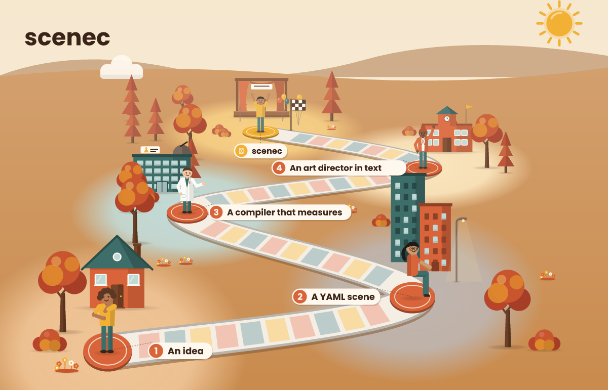

<h1 align="center">
  <picture>
    <source media="(prefers-color-scheme: dark)" srcset="design/svg/horizontal-dark.svg" />
    
  </picture>
</h1>

<p align="center">
  <strong>Illustrate with text: a YAML scene in, an SVG out, and written feedback on what is wrong with it.</strong>
  <br />
  <em>Drawing an image costs a fast CPU script, not an image model: cheap, repeatable and checked before you see it. Works with any AI that can run a command, such as Claude Code, Codex or Cursor.</em>
</p>

<p align="center">
  <a href="#quick-start"></a>
  <a href="https://www.npmjs.com/package/@guilhermebkel/scenec"></a>
  <a href="https://github.com/guilhermebkel/scenec/actions/workflows/ci.yml"></a>
  <a href="LICENSE"></a>
  
</p>

<p align="center">
  
  <br />
  <sub>How scenec was born, from an idea to this repo. Drawn by scenec itself from <a href="docs/assets/origin.yaml">a short YAML scene</a>.</sub>
</p>

---

**Image generation should be cheap, repeatable and checked.** An image model is slow and costly per picture, and two runs never give the same result. Hand-written SVG is cheap but has no feedback loop.

`scenec` gives any AI a closed vocabulary (86 assets, ready-made groups, a map of Europe, 6 styles) and a compiler, a fast script that runs on the CPU in a blink. It **measures what it drew** and returns the SVG plus warnings, an art director's critiques and a text description of where everything landed. The AI fixes the scene and runs it again until the report is clean, and it never needs to look at the picture to do so.

> **Fix the scene, not the SVG.** The skill tells the agent to never edit the SVG by hand: every correction goes back through the scene, so the result stays repeatable.

---

## What you get

<table>
<tr>
<td width="50%" valign="top">

**Warnings**

Fields it did not understand, with a "did you mean"; missing assets; objects out of frame. A typo costs one more cycle, not a failure.

</td>
<td width="50%" valign="top">

**Art critiques**

An art director's remarks in text: empty bands, overlaps, low contrast, a crowded corner, a scene too small for its frame.

</td>
</tr>
<tr>
<td valign="top">

**A description of the layout**

Position, size and depth of every object, so the AI can reason about composition without seeing it.

</td>
<td valign="top">

**Repeatable output**

The same scene gives the same SVG on any machine. A bundled font makes the PNG look the same everywhere.

</td>
</tr>
</table>

## Quick start

### 1. Install the skill

```bash
npx skills add guilhermebkel/scenec -g
```

The [`skills`](https://github.com/vercel-labs/skills) CLI asks which of your agents should get the skill. Drop `-g` to install only in the current project. Running scenec needs Node.js 20+.

### 2. Ask for an illustration

```text
Draw a vertical cover for a reel explaining compound interest, flat blue style.
```

The agent picks one of 8 recipes (reel, carousel, "wrapped" card, e-learning, illustrated story, route map, ad variations, product), changes the content, checks, fixes up to 5 times and renders.

### 3. Or use the CLI yourself

```bash
npx @guilhermebkel/scenec check scene.yaml                  # warnings and critiques; exit code 1 if there are any
npx @guilhermebkel/scenec render scene.yaml -o out --png    # out.svg and out.png, plus a JSON report
```

## Example

<sub>Real output of a first draft.</sub>

```yaml
canvas: { width: 1000, height: 1000, theme: flat-autumn, setting: outdoor, horizon: 0.6, base: 0.84 }
objects:
  arvore: { asset: tree, at: 0.15, depth: mid }
  menina: { asset: person, pose: hands_on_hips, at: 0.45, hair_color: red, size: large }
  rex:    { asset: dog, right_of: menina, facing: left }
  banco:  { asset: bench, at: 0.85 }
```

```text
$ npx @guilhermebkel/scenec check scene.yaml
warnings:
  'banco' is 10% outside the frame
  'rex' overlaps 'banco' by 36%; use left_of/right_of or a different depth
art:
  visual weight leans left (center of mass at 35% of the width); move 'arvore' toward the center or put something on the right side
  'rex' blends into the background in the middle part (41% of this outline has no contrast): the color #c9a27a is too close; change the color of one of the two
```

The agent moves the bench in, gives the dog another color, runs `check` again, and renders when the report is empty.

## What it draws

86 assets (people with poses and expressions, furniture, plants, food, vehicles, buildings), ready-made groups, a map of Europe with routes, and 6 kits:

| Kit | Look |
| --- | --- |
| `flat` | Flat vector with soft light (default) |
| `outline` | Cartoon outline: thick on the silhouette, thin inside |
| `hatch` | Engraving / comic: ink outline and hatched shadows |
| `riso` | Risograph: few vivid inks, print grain, slight misregistration |
| `paper` | Paper cut-out: each piece with its own shadow and fiber texture |
| `sketch` | Hand-drawn pencil look |

`npx @guilhermebkel/scenec catalog assets` lists everything; the full language is in [`skills/draw-scene/references/dsl.md`](skills/draw-scene/references/dsl.md).

## How it works

```text
  your scene ──▶ 1. PARSE ──▶ 2. COMPOSE ──▶ 3. DRAW ──▶ 4. CRITIQUE
  (YAML)         validate     place objects   SVG, kit    measure and
                 and suggest  in the frame    and light   write remarks
```

The work is split on purpose:

| Part | Does | Why |
| --- | --- | --- |
| **Pure core** (`@guilhermebkel/scenec`) | Parses, lays out and draws the SVG | Same scene, same SVG, on any machine. No file system, clock or randomness. |
| **Renderer** (`@guilhermebkel/scenec/render`) | Measures boxes, rasterizes PNG, runs the critic | Needs the native renderer ([resvg](https://github.com/yisibl/resvg-js)); kept out of the core. |
| **Your agent**, running the skill | Picks a recipe, writes the scene, reads the report, fixes | Taste and intent are the agent's job. |

### As a library

```ts
import { compile } from "@guilhermebkel/scenec";                  // pure: no native code, no file system
import { check, renderPng } from "@guilhermebkel/scenec/render";  // needs the native renderer
import { sceneJsonSchema, catalog } from "@guilhermebkel/scenec/schema";
```

<details>
<summary><b>CLI reference</b></summary>

| Command | What it does |
| --- | --- |
| `scenec render <scene.yaml> [-o name] [--png] [--width 1200]` | Writes the SVG (and PNG) and prints the JSON report. |
| `scenec check <scene.yaml>` | Compiles and critiques without writing files. Exit code 1 on a warning or critique, 2 when the scene is invalid. |
| `scenec catalog [assets\|groups\|kits\|themes\|poses\|layout]` | Lists the vocabulary a scene can use. |
| `scenec schema` | Prints the JSON Schema of the scene. |

Everything it prints is JSON (`schemaVersion: 1`).

</details>

## Privacy and safety

- **Everything runs locally.** No network calls, no telemetry. Nothing leaves your machine.
- **Files stay in the scene folder.** The file reader refuses `..` and absolute paths.
- **Custom SVG is allowlisted.** Scripts, `on*` handlers, external links, `<style>` and entities are removed or rejected.
- **Limits.** At most 200 objects and a 4096 px frame per scene.

Found a way around any of this? See [SECURITY.md](SECURITY.md).

## How it compares

- **Image-generation models** produce richer pictures, but need a model that can see, cost money per image and are not repeatable. `scenec` trades open-ended style for a closed vocabulary it can measure.
- **Hand-written SVG or diagram languages** (Mermaid, Graphviz) are repeatable, but give no feedback on composition and cover charts, not illustrated scenes.
- **Design tools with an API** need a canvas and a human eye in the loop.

## FAQ

<details>
<summary><b>Does it need an image model or a GPU?</b></summary>

No. It is plain CPU code: geometry, drawing and a rasterizer. Nothing is downloaded at run time.

</details>

<details>
<summary><b>Can I add my own drawings?</b></summary>

Yes. Under `assets:` a scene can bring an SVG (inline or a file next to the scene) or an image. Custom SVG goes through the sanitizer.

</details>

## Roadmap

- [x] **Core:** 86 assets, groups, map mode, 6 kits, warnings, critiques, CLI, skill, 120 visual baselines.
- [ ] **More recipes and assets** driven by real use of the skill.

## Contributing

Issues and pull requests are welcome. Start with [CONTRIBUTING.md](CONTRIBUTING.md); vocabulary is in [GLOSSARY.md](GLOSSARY.md) and design decisions in [`docs/adr/`](docs/adr/).

```bash
pnpm install
pnpm check   # typecheck, lint, dead code, duplication, tests, build, package checks and visual baselines
```

---

<p align="center">
  <strong>Let the AI draw. Let the compiler tell it what it drew.</strong>
</p>

<p align="center">
  <a href="https://www.star-history.com/#guilhermebkel/scenec&Date">
    <picture>
      <source media="(prefers-color-scheme: dark)" srcset="https://api.star-history.com/svg?repos=guilhermebkel/scenec&type=Date&theme=dark" />
      
    </picture>
  </a>
</p>

<p align="center">
  MIT License &copy; Guilherme Mota
</p>
